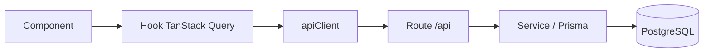
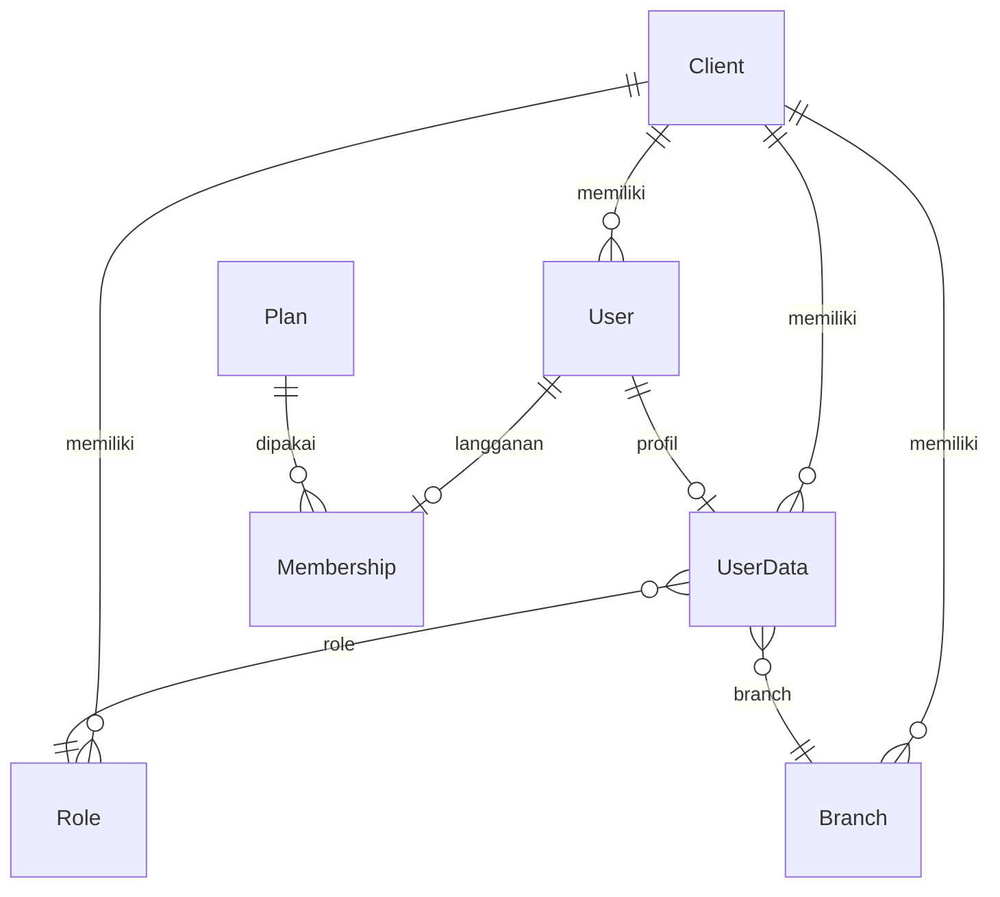

# Sera — Boilerplate Next.js + Prisma + Better Auth

Starter SaaS multi-tenant: autentikasi, onboarding client, role & branch, manajemen user, WhatsApp gateway (Evolution API + RabbitMQ), PWA, dan UI shadcn.

## Stack

| Bagian                    | Teknologi                                                |
| ------------------------- | -------------------------------------------------------- |
| Runtime & package manager | Bun                                                      |
| Framework                 | Next.js 16 (App Router, Turbopack, React 19, TypeScript) |
| Database                  | PostgreSQL + Prisma 7 (`@prisma/adapter-pg`)             |
| Auth                      | Better Auth (email/password, Google, admin plugin)       |
| Data client               | TanStack Query v5                                        |
| Tabel                     | TanStack Table v8                                        |
| UI                        | Tailwind CSS 4, shadcn/ui (Radix), lucide-react, Sonner  |
| Form & validasi           | React Hook Form, Zod                                     |
| Antrian & WhatsApp        | RabbitMQ (`amqplib`) + Evolution API                     |
| PWA                       | `@ducanh2912/next-pwa` (aktif hanya saat production)     |
| Pembayaran                | Midtrans (scaffold hook — route belum ada)               |

## Fitur

- Auth email/password + Google, session cookie cache 30 menit, admin plugin.
- Multi-tenant: setiap `Client` memiliki `User`, `UserData`, `Role`, `Branch`, dan `Announcement`.
- Onboarding otomatis membuat client + role Admin + branch `MAIN` + `userData` dalam satu transaksi.
- Dashboard: statistik user/role/branch, user terbaru, status WhatsApp.
- Master data: CRUD users, roles, branches; sinkronisasi user Better Auth.
- Profil pengguna.
- WhatsApp: kirim tunggal, kirim massal lewat queue, retry 1s → 5s → 30s, dan DLQ.
- Health check database di `/api/health`.
- PWA (install prompt) saat build production.

## Struktur Folder

```text
app/
  api/<resource>/route.ts        # HTTP boundary
  (public)/                      # landing + auth
  (dashboard)/dashboard/         # halaman setelah login
  onboarding/                    # pembuatan client pertama
components/
  ui/                            # primitive shadcn
  entry/                         # komponen halaman auth
  layout/                        # sidebar, shell, footer
  <fitur>/                       # komponen per fitur
hooks/<resource>/use<Resource>.ts # semua akses API dari client
lib/http/apiClient.ts            # wrapper fetch
prisma/
  schema.prisma                  # model + relasi
  migrations/                    # migrasi
  seed.ts                        # seed plan
  generated/                     # Prisma Client (hasil generate)
services/
  prisma.ts                      # singleton PrismaClient
  clients.ts                     # resolusi tenant + onboarding
  errorHandler.ts                # pemetaan error Prisma → HTTP
  auth/                          # Better Auth server & client
  whatsapp/                      # Evolution API
  rabbitmq/                      # koneksi, topologi, retry
types/                           # tipe bersama
worker/whatsappWorker.ts         # consumer RabbitMQ
config/menuGroupsSidebar.ts      # menu dashboard
```

## Alur Request



Aturan lengkap ada di `AGENTS.md`. Ringkasnya:

1. Backend dulu: `prisma/schema.prisma` → migrasi → route.
2. Buat hook di `hooks/<resource>/`.
3. Komponen hanya memakai hook; **jangan** import `apiGet/apiPost` langsung dan jangan pakai `useState` untuk loading request server.

## Setup Lokal

Prasyarat:

- Bun
- PostgreSQL yang bisa diakses dari mesin lokal
- (Opsional) RabbitMQ untuk fitur WhatsApp massal
- (Opsional) Instance Evolution API
- (Opsional) Google OAuth client

Langkah:

```bash
# 1. Install dependency
bun install

# 2. Buat file .env (lihat tabel Environment di bawah)

# 3. Migrasi + seed
bunx prisma migrate dev
bunx prisma db seed

# 4. Jalankan
bun run dev
```

Buka `http://localhost:3000`. Alur pertama: daftar → onboarding (buat client) → dashboard.

Untuk WhatsApp massal, jalankan worker di terminal terpisah:

```bash
bun run worker
```

Google OAuth: daftarkan redirect URI `${BETTER_AUTH_URL}/api/auth/callback/google`.

## Environment

Buat `.env` di root. File ini tidak ikut git.

| Variable                       | Wajib | Keterangan                                      |
| ------------------------------ | ----- | ----------------------------------------------- |
| `DATABASE_URL`                 | Ya    | Connection string PostgreSQL                    |
| `BETTER_AUTH_SECRET`           | Ya    | Secret Better Auth                              |
| `BETTER_AUTH_URL`              | Ya    | Base URL aplikasi, mis. `http://localhost:3000` |
| `GOOGLE_CLIENT_ID`             | Tidak | Diperlukan jika login Google dipakai            |
| `GOOGLE_CLIENT_SECRET`         | Tidak | Pasangan `GOOGLE_CLIENT_ID`                     |
| `NEXT_PUBLIC_CLIENT_NAME`      | Tidak | Nama aplikasi di metadata                       |
| `CLIENT_FAVICON`               | Tidak | Path favicon                                    |
| `CLIENT_APPLE_ICON`            | Tidak | Path apple touch icon                           |
| `NEXT_PUBLIC_CLIENT_ID`        | Tidak | Branding di landing; belum dipakai fungsional   |
| `NEXT_PUBLIC_CLIENT_IMAGE_URL` | Tidak | Branding di landing; belum dipakai fungsional   |
| `NEXT_PUBLIC_FILESERVER_URL`   | Tidak | Endpoint upload tanda tangan branch             |
| `NEXT_PUBLIC_EVO_URL`          | Tidak | Base URL Evolution API                          |
| `NEXT_PUBLIC_EVO_APIKEY`       | Tidak | API key Evolution API                           |
| `NEXT_PUBLIC_EVO_INSTANCE`     | Tidak | Nama instance, default `fajarsentosa`           |
| `RABBITMQ_URL`                 | Tidak | Wajib untuk WhatsApp massal                     |
| `NEXT_PUBLIC_MIDTRANS_*`       | Tidak | Scaffold Midtrans, belum dipakai route          |
| `PORT`                         | Tidak | Dipakai Docker Compose; default Next `3000`     |
| `COMPOSE_PROJECT_NAME`         | Tidak | Prefix nama image/container Docker              |
| `BYPASS_IMAGE_OPTIMIZATION`    | Tidak | `true` untuk melewati optimasi gambar           |

## Scripts

| Perintah                | Fungsi                       |
| ----------------------- | ---------------------------- |
| `bun run dev`           | Dev server (Turbopack)       |
| `bun run build`         | Build production (Turbopack) |
| `bun run build:webpack` | Build dengan webpack         |
| `bun run start`         | Jalankan hasil build         |
| `bun run worker`        | Consumer RabbitMQ WhatsApp   |
| `bun run lint`          | ESLint                       |
| `bun run lint:fix`      | ESLint + autofix             |
| `bun run format`        | Prettier write               |
| `bun run format:check`  | Cek format                   |
| `bun run typecheck`     | `tsc --noEmit`               |
| `bun run check`         | Lint + typecheck             |

Perintah Prisma:

```bash
bunx prisma migrate dev --name <nama>   # buat migrasi
bunx prisma migrate deploy              # terapkan migrasi di production
bunx prisma generate                    # regenerate client
bunx prisma db seed                    # seed plan
bunx prisma studio                     # buka GUI database
```

## Prisma

- Schema: `prisma/schema.prisma`. Generator menulis ke `prisma/generated`, jadi import client dari `@/prisma/generated/client`.
- Satu-satunya instance Prisma untuk aplikasi ada di `services/prisma.ts`. Jangan membuat `new PrismaClient()` di route/komponen.
- `prisma/seed.ts` mengisi `Plan` dari `lib/pricing.ts`.
- Setiap tabel memakai `@@map` snake_case dan index pada kolom filter.

Model utama:

| Model                                        | Fungsi                                                  |
| -------------------------------------------- | ------------------------------------------------------- |
| `User`, `Session`, `Account`, `Verification` | Tabel Better Auth                                       |
| `UserData`                                   | Profil karyawan/user + `clientId`, `roleId`, `branchId` |
| `Client`                                     | Tenant                                                  |
| `Role`                                       | Role per client + daftar permission (path)              |
| `Branch`                                     | Cabang per client                                       |
| `Plan`, `Membership`                         | Paket langganan                                         |
| `Notification`, `Announcement`               | Notifikasi dan pengumuman                               |



Menambah resource baru:

```bash
# 1. edit prisma/schema.prisma
bunx prisma migrate dev --name add_invoice
# 2. buat app/api/invoices/route.ts
# 3. buat hooks/invoices/useInvoices.ts
# 4. pakai hook di komponen
```

## Fungsi yang Harus Dipakai

### Hook client (utama)

| Hook                                                            | Endpoint                                    | Jenis              |
| --------------------------------------------------------------- | ------------------------------------------- | ------------------ |
| `useGetUsers()`                                                 | `GET /api/users`                            | query              |
| `useCreateUser()`                                               | `POST /api/users`                           | mutation           |
| `useUpdateUser()`                                               | `PUT /api/users`                            | mutation           |
| `useDeleteUser()`                                               | `DELETE /api/users`                         | mutation           |
| `useGetUserByIdBetterAuth(id)`                                  | `GET /api/users/byAuth/[id]`                | query              |
| `useGetUserByIdBetterAuthProfile(id)`                           | `GET /api/users/byAuth/[id]`                | query + retry      |
| `useGetRoles()`                                                 | `GET /api/roles`                            | query              |
| `useCreateRole()` / `useUpdateRole()` / `useDeleteRole()`       | `/api/roles`                                | mutation           |
| `useGetBranchs()`                                               | `GET /api/branches`                         | query              |
| `useCreateBranch()` / `useUpdateBranch()` / `useDeleteBranch()` | `/api/branches`                             | mutation           |
| `useGetClient()`                                                | `GET /api/clients`                          | query              |
| `useCreateClient()`                                             | `POST /api/clients`                         | mutation           |
| `useGetBetterAuth()`                                            | `GET /api/betterAuth/users`                 | query              |
| `useGetBetterAuthById(userId)`                                  | `POST /api/betterAuth/users`                | query              |
| `useGetBetterAuthWithoutUserData(clientId?)`                    | `GET /api/betterAuth/users/withoutUserData` | query              |
| `useGetConnectionBotWa()`                                       | `GET /api/whatsapp/bulk/send`               | query, refetch 30s |
| `useIsMobile()`                                                 | —                                           | media query        |

Contoh pemakaian:

```tsx
const { data: users = [], isLoading } = useGetUsers();
const createUser = useCreateUser();

await createUser.mutateAsync(payload);
createUser.isPending; // loading, bukan useState
```

Hook Midtrans (`useCreateSnapMidtransTransaction`, `useCheckMidtransTransactionStatus`, `useUpdateMidtransSuccessTransaction`, `useMidtransCheckStatusOderId`) sudah ada, tetapi route `/api/midtrans` dan `/api/payment/success` belum diimplementasikan.

### HTTP client

Hanya dipakai di dalam hook:

```ts
apiGet<T>(url, options?)                    // { data, status, statusText }
apiPost<T>(url, body?, options?)
apiPut<T>(url, body?, options?)
apiPatch<T>(url, body?, options?)
apiDelete<T>(url, options?)                 // body lewat options.body
```

Non-2xx selalu melempar `Error` dengan pesan dari `message`/`error` response. Di komponen, ubah ke teks dengan `getErrorMessage(error)`.

### Server

| Fungsi                                       | Kegunaan                                                                |
| -------------------------------------------- | ----------------------------------------------------------------------- |
| `prisma` (`@/services/prisma`)               | Akses database                                                          |
| `resolveClient(request, explicit?)`          | Ambil `clientId`/`userId` tenant; balikan `{ ok, response }` bila gagal |
| `clientUnauthorized()` / `clientForbidden()` | Response 401/403 standar                                                |
| `createClientForUser(userId, input)`         | Transaksi onboarding client                                             |
| `handlePrismaError(error)`                   | Petakan `P2002/P2003/P2025` ke response                                 |
| `auth` (`@/services/auth/auth`)              | `auth.api.getSession`, `auth.api.setRole`, dll.                         |
| `getWhatsAppConfig()`                        | Baca konfigurasi Evolution API                                          |
| `formatPhoneNumber(phone)`                   | Normalisasi ke format `62...`                                           |
| `sendWhatsAppMessage(number, text)`          | Kirim satu pesan, tidak pernah throw                                    |
| `getPublishChannel()`                        | Channel RabbitMQ untuk publish                                          |
| `openRabbit()` / `closeRabbit()`             | Lifecycle koneksi RabbitMQ                                              |
| `assertTopology(channel)`                    | Deklarasi exchange/queue/retry/DLQ                                      |
| `formatPrice(price)`                         | Format Rupiah                                                           |
| `getErrorMessage(error)`                     | Ambil pesan error yang aman ditampilkan                                 |

### Auth di client

```ts
import {
  signIn,
  signUp,
  signOut,
  useSession,
} from "@/services/auth/authClients";
```

## Endpoint API

| Method                         | Path                                    | Akses                              |
| ------------------------------ | --------------------------------------- | ---------------------------------- |
| `GET`                          | `/api/health`                           | Publik                             |
| `*`                            | `/api/auth/[...all]`                    | Publik (Better Auth)               |
| `GET`, `POST`                  | `/api/clients`                          | Session; belum butuh `clientId`    |
| `GET`, `POST`, `PUT`, `DELETE` | `/api/users`                            | Tenant (`resolveClient`)           |
| `GET`                          | `/api/users/[id]`                       | Tenant                             |
| `GET`                          | `/api/users/byAuth/[id]`                | Tenant                             |
| `GET`, `POST`, `PUT`, `DELETE` | `/api/roles`                            | Tenant                             |
| `GET`                          | `/api/roles/byUser/[id]`                | Tenant                             |
| `GET`, `POST`, `PUT`, `DELETE` | `/api/branches`                         | Tenant                             |
| `GET`, `POST`                  | `/api/betterAuth/users`                 | Tenant                             |
| `GET`                          | `/api/betterAuth/users/withoutUserData` | Tenant                             |
| `POST`                         | `/api/betterAuth/admin`                 | Tenant + admin                     |
| `POST`                         | `/api/whatsapp/send`                    | Session (proxy)                    |
| `GET`, `POST`                  | `/api/whatsapp/bulk/send`               | Session (proxy)                    |
| `GET`, `POST`                  | `/api/whatsapp/bulk/consumer`           | Legacy: kirim langsung tanpa queue |

`proxy.ts` menjaga `/dashboard`, `/onboarding`, dan `/api/*`. Pengecekan cookie hanya di production. Route bisnis tetap memvalidasi session lewat `resolveClient`; route WhatsApp mengandalkan proxy.

## Multi-Tenant & Onboarding

- `Client` adalah tenant. Hampir semua tabel bisnis punya `clientId`.
- `resolveClient` membaca `clientId` dari `User` lalu fallback ke `UserData`.
- Route bisnis wajib memakai `clientId` dari `resolveClient`, bukan dari body/query.
- User tanpa `clientId` diarahkan ke `/onboarding` oleh `app/(dashboard)/layout.tsx`.
- `POST /api/clients` membuat client, role Admin, branch `MAIN`, dan mengisi `userData` dalam satu transaksi.

## WhatsApp

Alur kirim massal:

```text
UI → POST /api/whatsapp/bulk/send → RabbitMQ queue → worker → Evolution API
```

- Route hanya publish lalu membalas; pengiriman dilakukan worker.
- Retry: `1s` → `5s` → `30s`, lalu DLQ.
- Maksimal 100 penerima per request.
- `{name}` diganti per penerima; `message` per penerima menang atas pesan batch.
- Worker: `bun run worker` (lokal) atau service `worker` di Docker Compose.

Kirim tunggal: `POST /api/whatsapp/send` dengan `{ "number": "08...", "text": "..." }`.

## Docker

Compose berisi `app`, `worker`, dan `docker-cleanup` (profile `cleanup`). Database dan RabbitMQ **tidak** disertakan; isi `DATABASE_URL` dan `RABBITMQ_URL` dari luar.

```bash
# .env.production harus memuat variabel runtime + PORT + COMPOSE_PROJECT_NAME
docker compose --env-file .env.production up -d --build
```

- `app`: Next.js standalone, healthcheck ke `/api/health`.
- `worker`: stage `worker` dari `Dockerfile`, menjalankan consumer RabbitMQ.
- `docker-cleanup`: opsional, `docker compose --profile cleanup up -d`.

Server scripts:

- `setup.sh` — pull, rebuild tanpa cache, dan bersihkan Docker. Jalankan di server, bukan untuk setup lokal.
- `dockerMaintenance.sh` — cleanup berkala (cocok untuk cron).

## Troubleshooting

| Gejala                                           | Penyebab / solusi                                                       |
| ------------------------------------------------ | ----------------------------------------------------------------------- |
| `Akun belum terhubung ke client` (403)           | Selesaikan `/onboarding`                                                |
| Import `@/prisma/generated/client` gagal         | `bunx prisma generate`                                                  |
| Bulk WhatsApp balas 503                          | `RABBITMQ_URL` kosong atau broker tidak terjangkau                      |
| Kirim WhatsApp balas 500 `configuration missing` | Set `NEXT_PUBLIC_EVO_URL` dan `NEXT_PUBLIC_EVO_APIKEY`                  |
| Login Google gagal                               | Cek redirect URI `${BETTER_AUTH_URL}/api/auth/callback/google`          |
| Build Docker gagal                               | Pastikan `.env.production` ada dan `COMPOSE_PROJECT_NAME`/`PORT` terisi |
