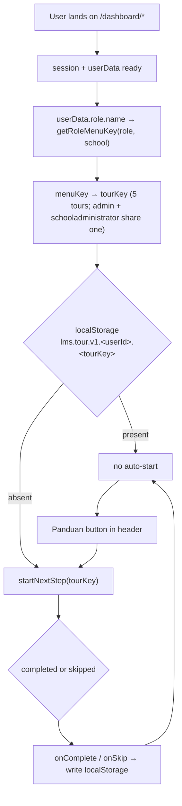

# Onboarding tour per role (nextstepjs) — Design

Date: 2026-10-11
Status: awaiting review
Scope owner: user picked "satu tur per role, lintas halaman", "otomatis saat pertama
kali, status di localStorage", and "kartu custom gaya house style" (the custom card was
recommended and left unchallenged; see §11).

## 1. Problem

A user who has just created an account lands in a 40+ page dashboard with no
explanation of it. Two gaps:

1. **No orientation.** `app/(frontend)/(dashboard)/` has 6 role menu sets
   (`menuGroupsSidebar.ts`) and 66 menu links. Nothing tells a new admin that Tahun
   Ajaran must exist before classes and billing, or that a guru marks attendance from
   `teacher/schedule`.
2. **Product knowledge is only on marketing pages.** `PRD.md` §"Support & Documentation"
   promises a *"User manual (in-app help)"*; no such surface exists in `app/`. The
   parent-facing explanation lives at `/landing/welcome` (`components/landing/Welcome.tsx`)
   and is unreachable once a user is inside the dashboard.

The user's requested mechanism: `nextstepjs` (+ `motion`) driving per-role tours across
pages, so a newly onboarded user is walked through the flow.

### Verified facts this design rests on

- `nextstepjs@2.3.0` — 0 dependencies, MIT, published 2026-07-20. Peer deps
  `next>=13`, `react>=18`, `motion>=11`, `react-dom>=18` — all satisfied here
  (Next 16.3.3, React 19.2.8, `motion@12.43.0` already a dependency).
- `dist/` calls `querySelector(step.selector)`, so **any CSS selector works**; adding
  `id` attributes across pages is not required.
- The built-in card uses inline styles and ships no CSS file and no `className` — so no
  Tailwind v4 `@source "../node_modules/nextstepjs"` registration is needed. The custom
  card we write uses our own classes, which Tailwind already scans.
- `Step` supports `scrollOffset` (sticky-header clearance), `selectorRetryAttempts` /
  `selectorRetryDelay` (async elements), `disableInteraction`, `nextRoute` / `prevRoute`
  (cross-page), `viewportID`.
- **A step whose selector matches nothing does not break the tour** — the card is
  centered at the top of the body instead. To be confirmed in verification (§10).
- Route audit against the filesystem (66 unique menu URLs): 3 are **dead** —
  `/dashboard/attendance`, `/dashboard/recapattendance`,
  `/dashboard/recapattendance/class` have no `page.tsx`. No tour step may use them.
  Fixing them is out of scope.

## 2. Goals

1. Each user gets one tour matching their role, spanning the pages they actually use.
2. The tour starts by itself the first time the user reaches the dashboard, and does not
   run again once completed or skipped — without a schema change and without an API route.
3. The user can replay their tour on demand from anywhere in the dashboard.
4. Every step targets an element that exists for that role **even when the tenant has no
   data yet** (a fresh admin has no academic year, no classes, no students).
5. No tour step points at a route the role does not have.
6. Landing and auth pages are unaffected.

## 3. Non-goals

- No persistence in PostgreSQL. No Prisma migration, no endpoint, no `user_data` column.
  Accepted consequence: status does not follow the user to another browser or device.
- No tour on the landing pages (`/`, `/landing/welcome`) or on auth screens.
- No new "panduan produk" page and no product-knowledge CMS. Explicitly dropped when the
  user redirected the request to the tour library.
- No polish of the landing page in this work (§11).
- Not fixing the 3 dead menu routes, and not fixing the branch `Select` that
  `appSidebar.tsx` imports but never renders.
- No per-page tours for all 40+ routes (user chose per-role tours).

## 4. Architecture

`ConditionalLayout` already splits fullscreen (auth/landing) from the sidebar shell, so
the tour provider mounts inside the dashboard branch only — landing keeps its own
`animate-element` cascade untouched.



`NextStepProvider` + `NextStep` wrap the shell; `NextStep` carries `steps`,
`cardComponent`, `onComplete`, `onSkip`, `shadowRgb`, `overlayZIndex`, and
`scrollToTop={false}` (a tour that jumps the page to top on finish loses the user's
place on long dashboard pages).

`NextStep` is only rendered after mount (`useEffect`-gated `mounted` state), so the tour
subtree never participates in SSR — no hydration mismatch from `matchMedia` or
`localStorage`.

## 5. Tour content

Five tours, keyed by `tourKey`. Step lists are built by `buildTours({ desktop, menuKey })`.

Common shape for every tour (desktop): sidebar navigation → header → the role's page
steps → sidebar footer (profile / switch account / sign out). On mobile the sidebar pair
collapses into the single trigger step described in §8.

| tourKey | roles (`menuKey`) | Steps after the chrome anchors |
|---|---|---|
| `admin` | `admin`, `schooladministrator` | `admin` only: Tahun Ajaran → Cabang/Sekolah → Users; both: Kelas → Presensi |
| `treasurer` | `treasurer` | Jenis Pembayaran → Tagihan → Pembayaran → Data Siswa |
| `teacher` | `teacher` | Jadwal → Presensi → Ujian → Pelanggaran |
| `student` | `student` | Jadwal → Presensi → Setoran Tahfidz → Tagihan SPP |
| `parent` | `parent` | Portal Orang Tua → Perkembangan Anak → Rapor |

`menuKey === "null"` (no role resolved) → no tour; the replay button starts nothing and
stays disabled.

Every route below was verified live (a `page.tsx` exists):

| tourKey | routes used as `nextRoute` |
|---|---|
| `admin` | `/dashboard/admin/master/academicyear`, `/dashboard/admin/master/branchs`, `/dashboard/admin/master/users`, `/dashboard/admin/master/classes`, `/dashboard/admin/attendance` |
| `treasurer` | `/dashboard/treasurer/paymenttype`, `/dashboard/treasurer/billing`, `/dashboard/treasurer/payment`, `/dashboard/treasurer/studentinformation` |
| `teacher` | `/dashboard/teacher/schedule`, `/dashboard/teacher/attendance`, `/dashboard/teacher/exam`, `/dashboard/teacher/violations` |
| `student` | `/dashboard/student/schedule`, `/dashboard/student/attendance`, `/dashboard/student/tahfidzrecord`, `/dashboard/student/payment` |
| `parent` | `/dashboard/parent`, `/dashboard/parent/development`, `/dashboard/parent/development/report` |

`admin`'s foundation-level steps (Tahun Ajaran, Cabang, Users) are excluded for
`schooladministrator`, whose menu set does not contain them — the step list is filtered
by `menuKey` so no step can point at a route the role lacks. The two roles therefore
share one tour definition without sharing routes they cannot reach.

Step targets:

| Target kind | Selector | Why stable |
|---|---|---|
| Sidebar navigation | `[data-slot="sidebar-content"]` | shadcn sidebar primitive, already in the tree |
| Sidebar footer / profile | `[data-slot="sidebar-footer"]` | same |
| Dashboard header | `[data-tour="header"]` | one attribute added to the `header` in `ConditionalLayout` |
| The page being explained | **no selector** — card renders centered | deliberate; see below |

Page-level steps carry **no selector on purpose**. Evidence from the 20 pages the tours
visit: 19 have no page-level `h1`/`h2`/`CardTitle` at all (`teacher/exam` is the only
one with a real `<h1>`; `student/schedule` and `student/attendance` have an `<h2>` buried
inside a section, at lines 433 and 560, not at page level). A step per page would
therefore need 20 bespoke, layout-dependent anchors — and nextstepjs has **no selector
fallback**: a selector that matches nothing already degrades to a centered card, which is
exactly what a selector-less step renders by design. So the page steps use the library's
documented no-selector behavior: the card explains the page while `nextRoute` takes the
user there, and the spotlight is reserved for the three chrome anchors that exist on
every page. `tours.ts` exports `TOUR_ROUTES` so the self-check asserts every route a step
uses has a `page.tsx` on disk.

Step-level options applied to every step that has a selector: `scrollOffset` tuned to the
sticky dashboard
header's real height during verification (start at 88 — the header is `px-4 py-7` plus a
`size-7` trigger), `selectorRetryAttempts: 3`, `selectorRetryDelay: 250` (pages fetch
through TanStack Query), and `pointerPadding: 8`, `pointerRadius: 12` to match the house
radii.

Copy is written in Bahasa Indonesia, matching the UI language rule. Icons are lucide
components, never emoji.

## 6. State and persistence

Single key per user per tour:

```
localStorage["lms.tour.v1.<userId>.<tourKey>"] = "done"
```

- Written on `onComplete(tourName)` and on `onSkip(step, tourName)` — the user's own
  "I've seen this" signal, whether they finished or bailed.
- Read once, on the first dashboard mount after `userData` resolves.
- Keyed by `userId`, so a second account signing in on the same browser is treated as new.
- `v1` in the key so a future content change can invalidate silently without a migration.
- Reading/writing is wrapped in `try/catch`: Safari private mode and disabled storage must
  degrade to "tour runs every time", never to a broken dashboard.
- Replay (`Panduan`) deliberately does **not** write; it only calls `startNextStep`.

`lib/ui/roleKey.ts` — the resolver currently living as a closure inside
`components/appSidebar.tsx` (`getRoleMenuKey`, lines 148–182) is extracted to
`getRoleMenuKey(role: string, school?: string)`. The sidebar imports it, and so does the
tour hook. One mapping, not two: a second copy would drift the moment a role is renamed.

## 7. Files

| File | Action | Contents |
|---|---|---|
| `package.json`, `bun.lock` | modify | `bun add nextstepjs` (2.3.0). `motion` already present — not added |
| `lib/ui/roleKey.ts` | new | `getRoleMenuKey(role, school?)`, extracted from `appSidebar` |
| `lib/tours/tourModel.ts` | new | pure, no React: `STORAGE_PREFIX`, `storageKey()`, `readTourDone()`, `writeTourDone()`, `tourKeyForMenuKey()`, `TourKey` |
| `lib/tours/selectors.ts` | new | selector constants + the `data-tour` names, one place both sides read |
| `lib/tours/tours.ts` | new | `buildTours({ desktop, menuKey })` → `Tour[]`, plus `TOUR_ROUTES`. `.ts`, not `.tsx`: step content is a string and no step renders an icon |
| `lib/tours/useTour.ts` | new | `useTourKey()`, `useTourAutoStart()`, `useTourReplay()` — the only React in `lib/tours` |
| `lib/tours/tour.check.ts` | new | assert-based self-check: role→menuKey→tourKey, storage-key shape, and every route in `TOUR_ROUTES` has a `page.tsx` |
| `components/tour/TourCard.tsx` | new | custom card in house style (`cardComponent`) |
| `components/tour/TourProvider.tsx` | new | `"use client"`; `NextStepProvider` + `NextStep`; mount-gated; writes status from `onComplete` / `onSkip` |
| `components/tour/TourReplayButton.tsx` | new | the header button, calling `useTourReplay()` |
| `components/appSidebar.tsx` | modify | import `getRoleMenuKey` instead of the local copy — no other change |
| `components/ConditionalLayout.tsx` | modify | wrap the shell branch in `TourProvider`; `data-tour="header"`; render `TourReplayButton` |
| `AGENTS.md` | modify | §Testing: add `bun run lib/tours/tour.check.ts` next to the existing `retry.check.ts` line |

No dashboard page is edited; §5 explains why.

`TourCard.tsx` — nextstepjs strips `showControls` / `showSkip` from the step types when
`cardComponent` is supplied, so the card owns its own controls. It receives
`{ step, currentStep, totalSteps, nextStep, prevStep, skipTour, arrow }` and renders:
house tokens (`bg-card`, `border-border`, `rounded-3xl`, `shadow-md`), the step title and
content, a `Button` for Lanjut/Kembali and a ghost button for Lewati, plus a
`currentStep + 1 / totalSteps` counter in `text-muted-foreground`. Transitions use the
same cubic-bezier as `cascade-in` in `globals.css` for consistency with the rest of the
app. No emoji.

## 8. Mobile

Below `768px` the sidebar is an off-canvas `Sheet` (`components/ui/sidebar.tsx`), so
`[data-slot="sidebar-content"]` is not in the DOM. `buildTours({ desktop: false })`
therefore replaces the two sidebar-anchor steps with a single step targeting
`[data-slot="sidebar-trigger"]` (the header button that opens the sheet) and keeps only
the page-level steps. The closing step loses its selector too (`CLOSING_STEP_MOBILE`): the
profile block lives in the off-canvas sidebar, so a footer-targeted step would highlight
nothing — it renders as a centered card instead. `desktop` comes from
`window.matchMedia("(min-width: 768px)").matches`, read inside the mount-gated
`useEffect` — never during render, so SSR and client agree.

## 9. Risks

| Risk | Mitigation |
|---|---|
| Sticky header covers the highlighted element | `scrollOffset: 88` on every step |
| Target element renders after data fetch | `selectorRetryAttempts: 3`, `selectorRetryDelay: 250` |
| Fresh tenant: empty pages | Page steps carry no selector, so an empty page changes nothing; no step points at data, a table row, or a metric |
| Tour points at a route the role lacks | Routes pinned to the audited per-role live lists in §5; `admin`-only steps filtered by `menuKey` |
| Dead menu routes (3 found) leaked into a step | Audit result recorded in §1; none of the 5 tours uses them |
| Sidebar off-canvas on mobile | Separate mobile step list (§8) |
| Hydration mismatch from `matchMedia` / `localStorage` | `NextStep` renders only after mount |
| `localStorage` unavailable (private mode) | `try/catch` on read and write; degrades to "runs every time" |
| Double auto-start (React 19 StrictMode remounts, re-renders) | `useRef` latch for the whole session, plus a check of `isNextStepVisible` from `useNextStep()` |
| Tour content drifts when a menu route is moved or deleted | `lib/tours/tour.check.ts` asserts every route in `TOUR_ROUTES` has a `page.tsx`; run it after any route change |
| Landing/auth animations disturbed | Provider is mounted inside the dashboard branch of `ConditionalLayout` only |

## 10. Verification

No test framework exists in this repo (`AGENTS.md` §Testing), so verification is:

0. **Prerequisite:** a working account for the browser walkthrough — the dashboard needs
   a Better Auth session plus a `user_data` row, so a tour cannot be driven without
   signing in. If no admin/yayasan test account is available, verification stops at the
   self-check, `tsc`, and `build`, and the browser walkthrough is handed to the user.

1. `bun run lib/tours/tour.check.ts` — assert-based, no broker/framework, matching the
   existing `lib/rabbitMQ/retry.check.ts` convention. Covers role→menuKey→tourKey mapping
   (including `null`, and `admin` vs `schooladministrator`), the storage-key shape, and
   that every route in `TOUR_ROUTES` resolves to a real `page.tsx`.
2. Browser, dev server on `:8999`:
   - clear `localStorage` → sign in as admin → tour auto-starts, 8 steps (5 if a branch is
     already selected), cross-page
     `nextRoute` navigation lands and the highlight appears;
   - a step whose target is missing degrades to a centered card (confirms the
     `nextstepjs` behavior assumed in §9);
   - reload → no auto-start; `Panduan` → replay works;
   - viewport 390px → sidebar steps replaced by the trigger step;
   - dark mode → card reads correctly;
   - console free of errors/warnings for the tour subtree.
3. `bunx tsc --noEmit`, then `bun run build`.

## 11. Open decisions

1. **Custom vs built-in card.** The user's answer to the card question was empty. This
   spec assumes the recommended custom card (`components/tour/TourCard.tsx`). Dropping it
   is a one-line change: omit `cardComponent` and the built-in card renders — the two
   deleted files are `TourCard.tsx` and its import.
2. **5 tours vs 6 menu keys.** `getRoleMenuKey` can return 6 keys. This spec keeps the
   approved 5 tours and shares `admin` between `admin` and `schooladministrator` by
   filtering the step list per `menuKey`, rather than adding a 6th tour.
3. **Landing-page polish** (`/`, `/landing/welcome`) from the original request is
   deferred and not covered here.
4. **Persistence is per browser.** If the tour status must follow the user across devices
   later, that is a `user_data` column plus an endpoint — a separate change.
